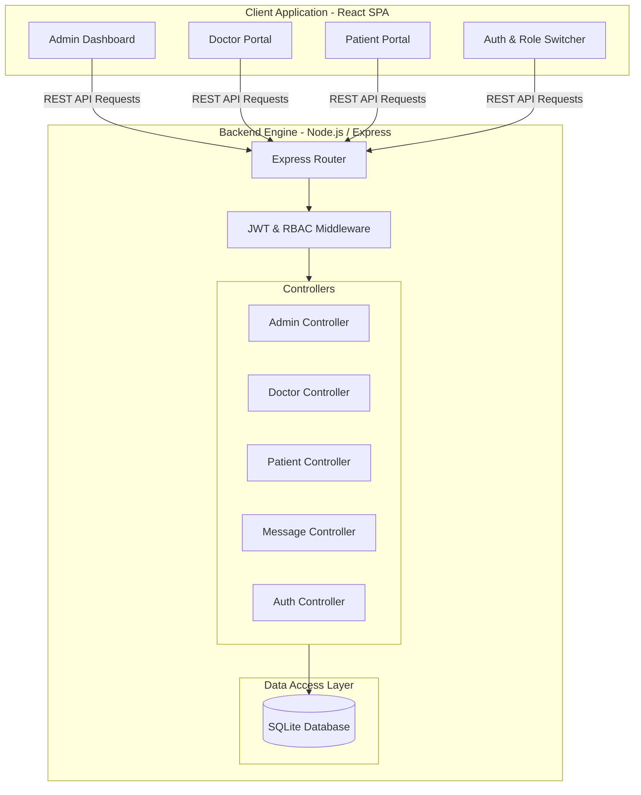
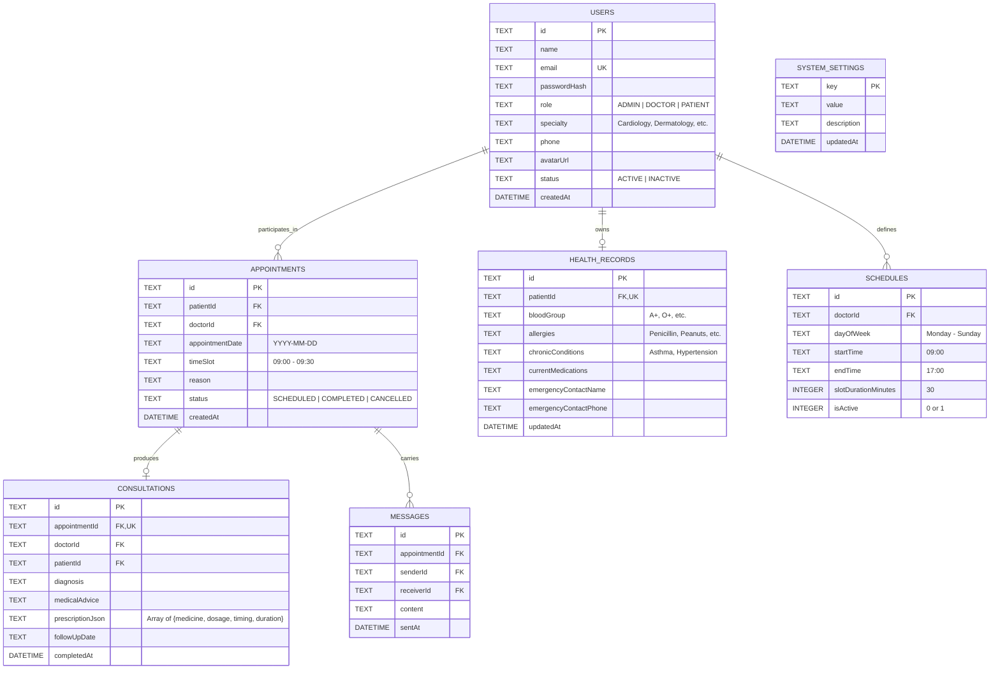
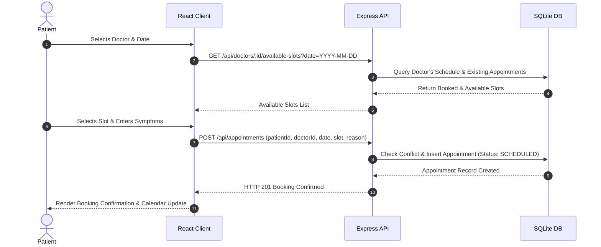
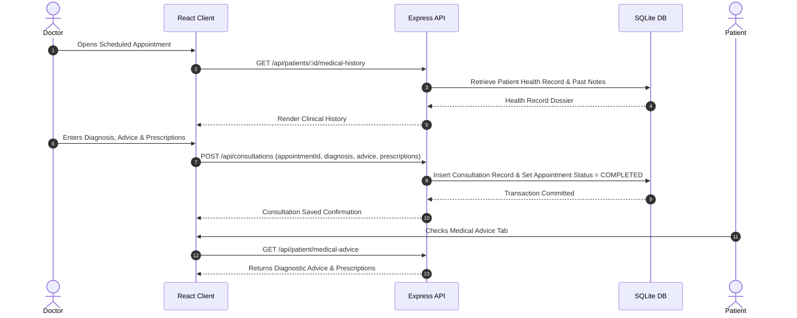

# System Architecture & Technical Design Document (TDD)
## Project 12: Online Health Consultation Platform

---

## 1. System Overview
The **Online Health Consultation Platform** is engineered following the **Model-View-Controller (MVC)** and **Layered Architecture** paradigms. The client application is decoupled from the backend API server, communicating strictly via RESTful JSON over HTTPS.



---

## 2. Component Layers

### 2.1 Presentation Layer (Frontend)
* Built with **React 18** and **Vite** for rapid bundling and HMR.
* **Tailwind CSS** provides utility-based styling with design tokens optimized for healthcare workflows (calm blues, emerald greens, and high contrast status badges).
* **React Router v6** manages route transitions with client-side RBAC wrappers (`<ProtectedRoute allowedRoles={['ADMIN']} />`).
* Dynamic state management via React Context (`AuthContext`, `NotificationContext`).

### 2.2 API & Middleware Layer (Backend)
* **Express.js** provides REST route definition.
* **CORS** middleware enables secure cross-origin resource sharing.
* **JWT Authentication Middleware (`verifyToken`)**: Decodes and verifies token signatures from the `Authorization: Bearer <token>` header.
* **Role Guard Middleware (`requireRole(['ADMIN', ...])`)**: Intercepts requests and enforces authorization before controller execution.

### 2.3 Persistence Layer (Database)
* **SQLite** managed using `better-sqlite3` for synchronous, low-latency, zero-overhead database transactions.
* Foreign key constraints enforced (`PRAGMA foreign_keys = ON;`).
* Tables indexed on search columns (`email`, `patientId`, `doctorId`, `appointmentDate`, `status`).

---

## 3. Entity-Relationship (ER) Schema



---

## 4. End-to-End Data Workflows

### 4.1 Consultation Booking Workflow


### 4.2 Consultation Provision & Medical Advice Workflow


---

## 5. Security & Role-Based Access Matrix

| Resource / Action | Admin | Doctor | Patient | Public |
| :--- | :---: | :---: | :---: | :---: |
| **Register / Login** | ❌ (Pre-created) | ❌ (Admin-managed) | ✅ | ✅ |
| **User CRUD** | ✅ | ❌ | ❌ | ❌ |
| **System Settings** | ✅ | ❌ | ❌ | ❌ |
| **System Analytics** | ✅ | ❌ | ❌ | ❌ |
| **Set Doctor Schedule** | ❌ | ✅ (Own) | ❌ | ❌ |
| **View Available Slots** | ✅ | ✅ | ✅ | ✅ |
| **Book Appointment** | ❌ | ❌ | ✅ | ❌ |
| **Provide Consultation / Advice** | ❌ | ✅ (Assigned) | ❌ | ❌ |
| **View Patient Health Record** | ✅ (Audit) | ✅ (During consult) | ✅ (Own) | ❌ |
| **Update Health Record** | ❌ | ❌ | ✅ (Own) | ❌ |
| **Chat / Messages** | ❌ | ✅ (Involved) | ✅ (Involved) | ❌ |

---

## 6. Directory Structure
```
shreya/
├── docs/
│   ├── PRD.md
│   ├── ARCHITECTURE.md
│   ├── API_DOCUMENTATION.md
│   ├── PRESENTATION.md
│   └── presentation.html
├── server/
│   ├── package.json
│   ├── server.js
│   └── src/
│       ├── config/
│       ├── controllers/
│       ├── db/
│       │   ├── database.js
│       │   └── seed.js
│       ├── middleware/
│       └── routes/
├── client/
│   ├── package.json
│   ├── index.html
│   ├── vite.config.js
│   ├── tailwind.config.js
│   └── src/
│       ├── components/
│       ├── context/
│       ├── pages/
│       │   ├── admin/
│       │   ├── doctor/
│       │   ├── patient/
│       │   └── auth/
│       ├── services/
│       └── App.jsx
└── README.md
```
